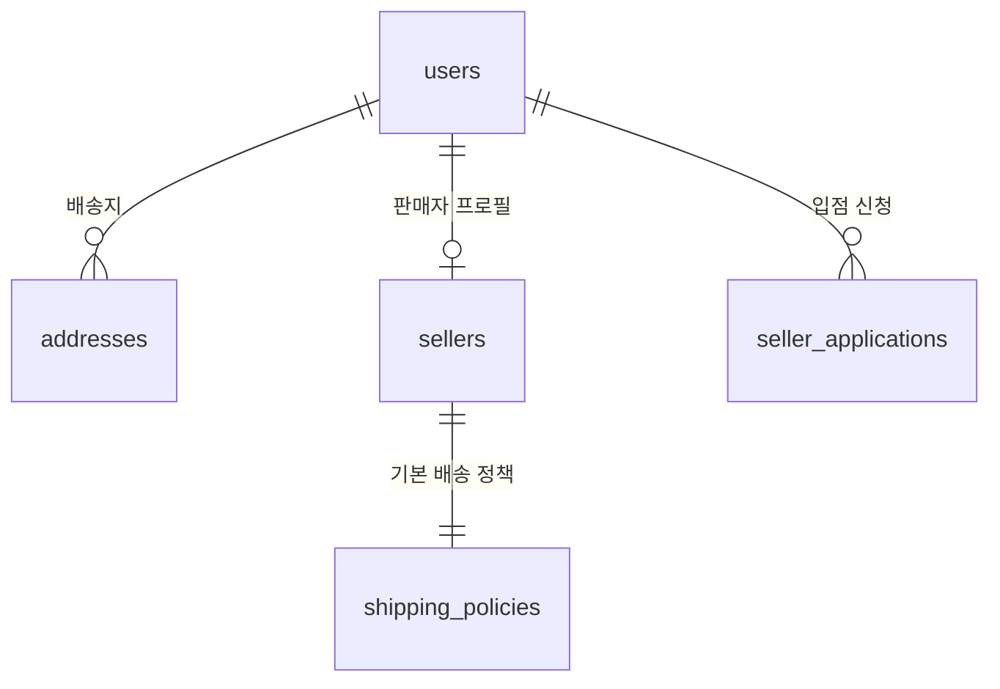
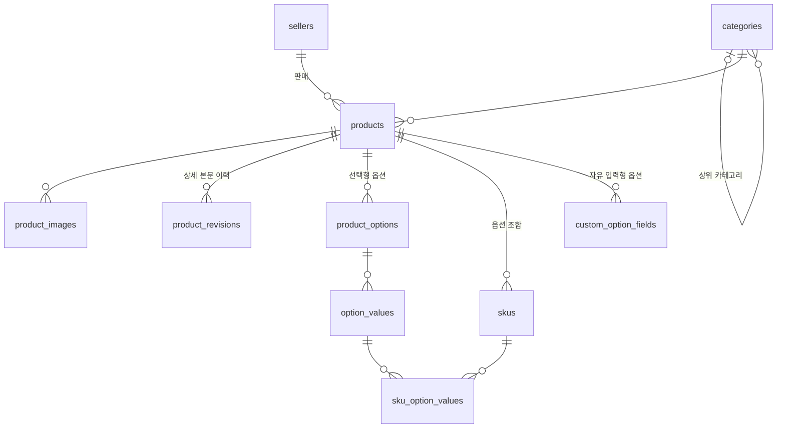
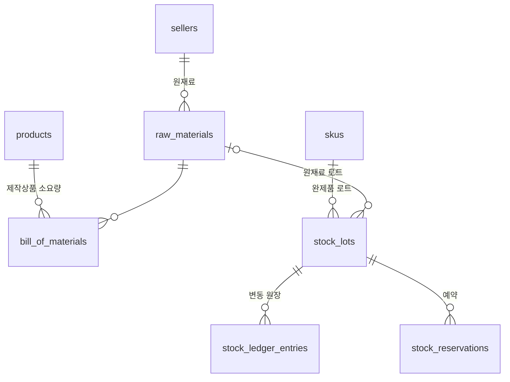

# 도메인 모델 (ERD)

커머스 DB(Postgres)의 테이블과 관계. 엔티티 목록의 원본은 핸드북 `architecture.md` "도메인 모델"이고, 이 문서는 그것을 테이블·관계·컬럼으로 내린다. 스키마 코드(`db/schema/`)를 바꾸면 이 문서도 같은 PR에서 고친다.

## 테이블 공통 규칙

| 대상 | 규칙 | 예 |
|---|---|---|
| 테이블 이름 | snake_case 복수 | `users`, `order_items` |
| 컬럼 이름 | snake_case. Drizzle에서 이름을 직접 적는다 | `uuid('seller_id')` → TS `sellerId` |
| 기본 키 | `id uuid DEFAULT uuidv7()` | 시간순으로 정렬되는 UUID(Postgres 18 내장) |
| 외래 키 | `<참조 단수>_id`, 기본 `ON DELETE RESTRICT` | `seller_id` |
| 시각 | `created_at`, `updated_at`: `timestamptz NOT NULL DEFAULT now()`. `updated_at`은 앱이 갱신 | |
| 금액 | 원 단위 `integer`, `CHECK (>= 0)`. 합계·정산 금액은 `bigint` | `price`, `total_amount` |
| 상태·유형 | Postgres enum, 값은 UPPER_SNAKE_CASE(스펙과 같은 값). 값은 추가만 한다 | `product_status` |
| 동시 수정 | 여러 사람이 고치는 행은 `version integer`로 낙관적 락 | `products.version` |
| 삭제 | 기본은 실제 삭제하지 않고 상태로 표현. 필요한 테이블만 `deleted_at` | |
| 제약·인덱스 이름 | `<테이블>_<컬럼>_<종류>` (`pkey`, `fkey`, `key`, `idx`, `check`) | `products_seller_id_idx` |

## 모듈 소유

- 테이블마다 소유 모듈이 하나다. 아래 다이어그램은 소유 모듈별로 나눈다
- 다른 모듈의 테이블은 읽지 않는다(CLAUDE.md "모듈 경계"). 대신 **모듈 간 외래 키는 둔다**: 조회는 공개 인터페이스로 하되, 참조 무결성은 DB가 지킨다
- 다른 레포가 소유하는 데이터(shop-sim-vendor의 운송장·모의 PG 거래, shop-sim-loadtest의 시뮬레이션)는 커머스 DB에 두지 않는다. 커머스 DB에는 외부 식별자(운송장 번호, PG 거래 ID)만 저장한다

## 관계도

`||--o{` 1:N, `|o--o{` 0..1:N(부모가 없을 수 있음), `||--o|` 1:0..1, `||--||` 1:1. 다른 모듈의 테이블은 관계를 보여 주기 위해 함께 그린다.

### 회원·판매자 (user, auth, seller, admin)

- **미정: Better Auth POC(#17) 후 확정** — `users`와 인증 테이블(세션, 소셜 계정)은 Better Auth가 정의한다. 운영자 계정을 `users`와 분리할지(입점 심사자 참조 포함)도 POC 결론을 따른다
- 입점 신청은 거절 후 재신청할 수 있어 `users` 1:N. 승인되면 `sellers`가 만들어진다

### 카탈로그 (catalog)

- `sku_option_values`는 SKU 하나가 어떤 옵션 값 조합인지 기록하는 연결 테이블이다(SKU ↔ 옵션 값 N:M). 옵션이 없는 상품도 SKU 1개를 가진다

### 재고 (inventory)

- `stock_lots`는 완제품(SKU) 또는 원재료 중 정확히 하나를 가리킨다(`CHECK`로 강제)
- 재고 수량의 원본은 원장(`stock_ledger_entries`)이고, `stock_lots.quantity`는 원장 합계를 캐시한 값이다
- 예약은 로트 단위다. 유효기한이 가까운 로트부터 예약한다(FEFO). 주문 항목과의 관계는 주문 관계도에서 그린다
