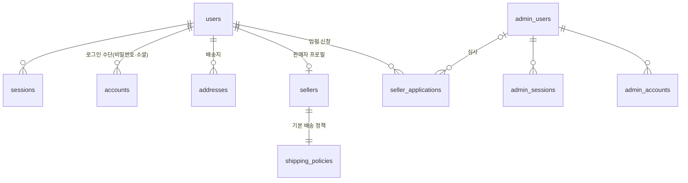
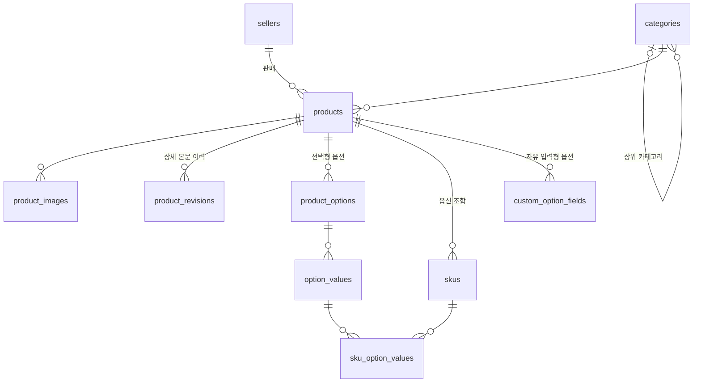
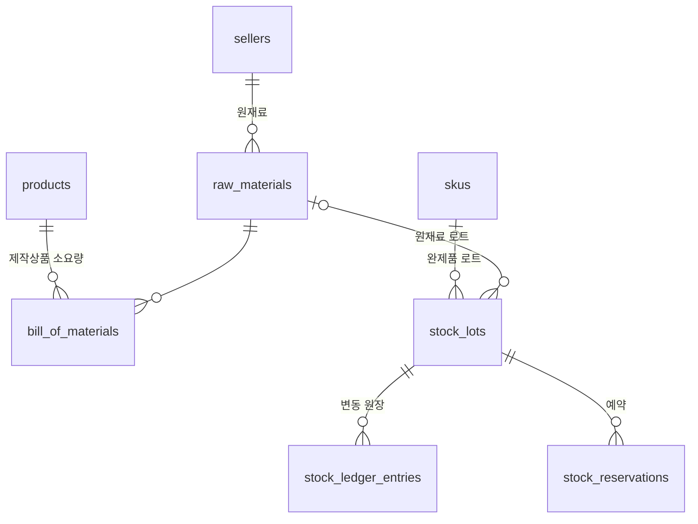
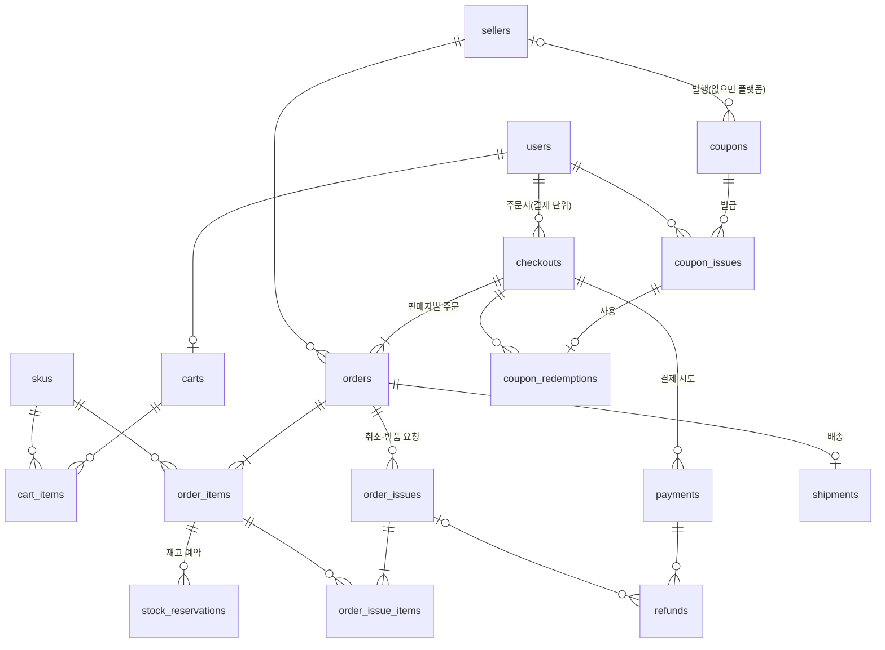
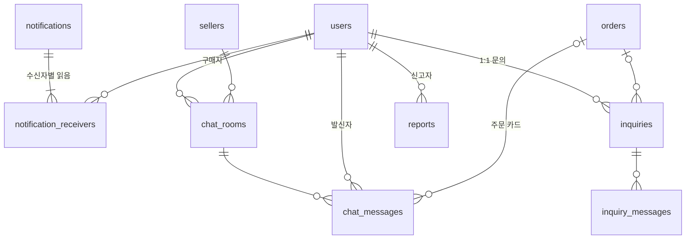
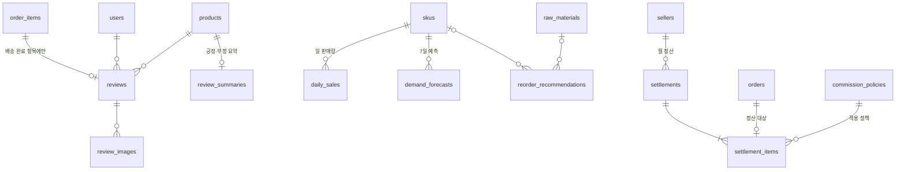

# 도메인 모델 (ERD)

커머스 DB(Postgres)의 테이블과 관계. 엔티티 목록의 원본은 핸드북 `architecture.md` "도메인 모델"이고, 이 문서는 그것을 테이블·관계·컬럼으로 내린다. 스키마 코드(`db/schema/`)를 바꾸면 이 문서도 같은 PR에서 고친다.

## 테이블 공통 규칙

| 대상 | 규칙 | 예 |
|---|---|---|
| 테이블 이름 | snake_case 복수 | `users`, `order_items` |
| 컬럼 이름 | snake_case. Drizzle에서 이름을 직접 적는다 | `uuid('seller_id')` → TS `sellerId` |
| 기본 키 | `id uuid DEFAULT uuidv7()` | 시간순으로 정렬되는 UUID(Postgres 18 내장) |
| 외래 키 | `<참조 단수>_id`, 기본 `ON DELETE RESTRICT` | `seller_id` |
| 시각 | `created_at`, `updated_at`: `timestamptz NOT NULL DEFAULT now()`. `updated_at`은 앱이 갱신 | |
| 금액 | 원 단위 `integer`, `CHECK (>= 0)`. 합계·정산 금액은 `bigint` | `price`, `total_amount` |
| 상태·유형 | Postgres enum, 값은 UPPER_SNAKE_CASE(스펙과 같은 값). 값은 추가만 한다 | `product_status` |
| 동시 수정 | 여러 사람이 고치는 행은 `version integer`로 낙관적 락 | `products.version` |
| 삭제 | 기본은 실제 삭제하지 않고 상태로 표현. 필요한 테이블만 `deleted_at` | |
| 제약·인덱스 이름 | `<테이블>_<컬럼>_<종류>` (`pkey`, `fkey`, `key`, `idx`, `check`) | `products_seller_id_idx` |

## 모듈 소유

- 테이블마다 소유 모듈이 하나다. 아래 다이어그램은 소유 모듈별로 나눈다
- 다른 모듈의 테이블은 읽지 않는다(CLAUDE.md "모듈 경계"). 대신 **모듈 간 외래 키는 둔다**: 조회는 공개 인터페이스로 하되, 참조 무결성은 DB가 지킨다
- 다른 레포가 소유하는 데이터(shop-sim-vendor의 운송장·모의 PG 거래, shop-sim-loadtest의 시뮬레이션)는 커머스 DB에 두지 않는다. 커머스 DB에는 외부 식별자(운송장 번호, PG 거래 ID)만 저장한다

## 관계도

`||--o{` 1:N, `||--|{` 1:1..N, `|o--o{` 0..1:N(부모가 없을 수 있음), `||--o|` 1:0..1, `||--||` 1:1. 다른 모듈의 테이블은 관계를 보여 주기 위해 함께 그린다.

### 회원·판매자 (user, auth, seller, admin)

- 인증 테이블은 Better Auth가 쓴다(ADR 0015). 운영자는 별도 인스턴스라 `admin_*` 테이블이 같은 구조로 따로 있다. `verifications`(이메일 인증·비밀번호 재설정 토큰)는 관계가 없어 생략
- 입점 신청은 거절 후 재신청할 수 있어 `users` 1:N. 승인되면 `sellers`가 만들어진다

### 카탈로그 (catalog)

- `sku_option_values`는 SKU 하나가 어떤 옵션 값 조합인지 기록하는 연결 테이블이다(SKU ↔ 옵션 값 N:M). 옵션이 없는 상품도 SKU 1개를 가진다

### 재고 (inventory)

- `stock_lots`는 완제품(SKU) 또는 원재료 중 정확히 하나를 가리킨다(`CHECK`로 강제)
- 재고 수량의 원본은 원장(`stock_ledger_entries`)이고, `stock_lots.quantity`는 원장 합계를 캐시한 값이다
- 예약은 로트 단위다. 유효기한이 가까운 로트부터 예약한다(FEFO). 주문 항목과의 관계는 주문 관계도에서 그린다

### 주문·결제·배송·쿠폰 (order, payment, coupon, shipment)

- 결제는 주문서(`checkouts`) 단위로 한 번, 배송은 판매자별 주문(`orders`) 단위다. 여러 판매자 상품을 한 번에 결제하면 주문서 1개에 주문 N개
- `payments`는 주문서당 여러 행일 수 있다(실패 후 재시도). 승인된 결제는 주문서당 최대 1개(부분 유니크 인덱스)
- 주문 항목은 가격·할인·옵션 입력값을, 주문은 배송지를 **스냅샷**으로 복사한다. 상품·배송지가 나중에 바뀌어도 주문은 그대로다
- 쿠폰 사용은 주문서에 기록하고, 할인액은 주문 항목별로 나눠 스냅샷에 적는다(부분 취소·정산 계산용)
- 환불은 결제에 묶인다. 판매자 취소처럼 요청 없이 생기는 환불도 있어 `order_issues`와의 관계는 0..1
- 운송장 상세·상태 이력은 shop-sim-vendor가 소유한다. `shipments`에는 택배사, 운송장 번호, 마지막으로 동기화한 상태만 둔다

### 알림·채팅·고객센터 (notification, chat, support)

- `chat_rooms`는 (구매자, 판매자) 쌍마다 하나(유니크). 핸드북의 "연결된 주문"은 방이 아니라 메시지(주문 카드)에 둔다. 한 방에서 여러 주문을 이야기할 수 있기 때문이다
- `reports`의 신고 대상(상품·리뷰·판매자·채팅 메시지)은 9단계에서 정한다. `stock_lots`처럼 대상별 nullable 외래 키 + `CHECK`가 기본안

### 리뷰·분석·정산 (review, analytics, forecast, settlement)

- 리뷰는 주문 항목당 최대 1개. 구매 검증과 "자기 스토어 상품 리뷰 금지"(ROADMAP 2단계)의 근거가 주문 항목이다
- 일 판매량·예측은 SKU 단위로 쌓고 상품 단위는 합산한다(재고·발주가 SKU·원재료 단위라서)
- 주문은 한 번만 정산된다(`settlement_items.order_id` 유니크). 수수료율은 정산 항목에 스냅샷으로 복사한다

### 관계 없이 쓰는 테이블

| 테이블 | 소유 | 이유 |
|---|---|---|
| `outbox_messages`, `processed_messages` | 공통(이벤트) | 집계 ID를 값으로만 담는다. 이벤트는 행이 지워진 뒤에도 남아야 한다 |
| `batch_runs`, `review_summary_runs` | 공통, review | 실행 이력 |
| `audit_logs` | audit | 행위자가 일반 계정·운영자 두 종류다. 형태는 Better Auth POC(#17) 후 확정 |
| `notices`, `faqs` | support | 작성자(운영자) 참조는 #17 후 확정 |

**다른 레포 소유 데이터 점검**: 운송장 상세·이력(`Tracking`·`TrackingLog`), 모의 PG 거래는 shop-sim-vendor, `SimulationScenario`·`SimulationRun`은 shop-sim-loadtest에 있다. 커머스 DB에는 외부 식별자만 둔다(`shipments.tracking_number`, `payments.pg_transaction_id`).

## 컬럼 (1~3단계)

공통 규칙의 `id`, `created_at`, `updated_at`은 생략한다.

### 회원 1: 인증 (Better Auth, ADR 0015)

Better Auth가 읽고 쓰는 테이블이다. TS 키는 Better Auth 필드 이름과 같아야 하고, 컬럼 이름·타입·제약은 공통 규칙을 따른다. 정의 원본은 `poc/better-auth` 브랜치의 `src/db/auth-schema.ts`(접두사 `''` / `'admin_'`로 두 벌 생성). 운영자 쪽 `admin_*`는 구조가 같아 생략한다.

| 테이블 | 컬럼 | 제약 |
|---|---|---|
| `users` | `name`, `email`, `email_verified`(boolean), `image`, **`is_test_account`**(boolean, NOT NULL DEFAULT false) | `users_email_key` UNIQUE |
| `sessions` | `user_id`, `token`, `expires_at`, `ip_address`, `user_agent` | `token` UNIQUE, `user_id` FK `ON DELETE CASCADE` |
| `accounts` | `user_id`, `provider_id`(`credential` / `google` / `kakao` / `naver`), `account_id`, 토큰·만료 컬럼, `password`(해시, `credential`만) | UNIQUE (`provider_id`, `account_id`), `user_id` FK `ON DELETE CASCADE` |
| `verifications` | `identifier`, `value`, `expires_at` | 인덱스 `identifier` |

- `is_test_account`는 Better Auth의 `user.additionalFields`로 등록하고 `input: false`로 둔다(가입 요청으로 설정할 수 없게). 시뮬레이터 봇 계정만 서버에서 켠다
- 세션·계정의 `CASCADE`는 공통 규칙의 예외다. 사용자에게 완전히 딸린 행이다
- 회원 탈퇴는 `users` 행을 지우지 않는다(주문·리뷰가 참조). 개인정보 컬럼을 익명화하고 세션·계정 행을 지운다. 절차는 2단계에서 정한다
- Better Auth를 업그레이드하거나 플러그인을 더하면 `@better-auth/cli generate`로 만든 기준 스키마와 비교해 빠진 필드를 추가한다

### 회원 2: 배송지, 판매자, 입점 신청, 배송 정책

**`addresses`**: `user_id`(FK), `recipient_name`, `phone`, `zip_code`, `address1`, `address2`, `is_default`(boolean). 기본 배송지는 사용자당 하나: UNIQUE (`user_id`) `WHERE is_default`

**`sellers`**
| 컬럼 | 타입 | 제약 | 설명 |
|---|---|---|---|
| `user_id` | uuid | NOT NULL, UNIQUE, FK `users` | 1계정 1스토어 |
| `store_name` | text | NOT NULL, UNIQUE | |
| `description` | text | | |
| `brand_image_key` | text | | R2 객체 키 |
| `status` | `seller_status` | NOT NULL DEFAULT `ACTIVE` | `ACTIVE` / `SUSPENDED`(운영 제재) |

**`seller_applications`**
| 컬럼 | 타입 | 제약 | 설명 |
|---|---|---|---|
| `user_id` | uuid | NOT NULL, FK `users` | |
| `store_name` | text | NOT NULL | 승인되면 `sellers`로 복사 |
| `business_name`, `business_number`, `representative_name` | text | NOT NULL | 상호, 사업자등록번호, 대표자 |
| `bank_code` | text | NOT NULL | |
| `account_number_encrypted` | bytea | NOT NULL | 정산 계좌. 앱에서 암호화해 저장 |
| `account_number_last4` | text | NOT NULL | 화면 표시용(`****1234`) |
| `status` | `seller_application_status` | NOT NULL DEFAULT `SUBMITTED` | `SUBMITTED` / `APPROVED` / `REJECTED` |
| `reviewed_by` | uuid | FK `admin_users`, 심사 전 NULL | |
| `reviewed_at` | timestamptz | | |
| `reject_reason` | text | `REJECTED`면 NOT NULL (CHECK) | |

심사 대기 신청은 사용자당 하나: UNIQUE (`user_id`) `WHERE status = 'SUBMITTED'`. 심사 큐 조회용 인덱스 (`status`, `created_at`)

**`shipping_policies`**: `seller_id`(NOT NULL, UNIQUE, FK), `base_fee`(integer, ≥ 0), `free_shipping_threshold`(integer, NULL이면 무료배송 없음), 출고지 `zip_code`, `address1`, `address2`

### 카탈로그 1: 카테고리, 상품, 이미지, 본문 이력

**`categories`**
| 컬럼 | 타입 | 제약 | 설명 |
|---|---|---|---|
| `parent_id` | uuid | FK `categories`, NULL이면 최상위 | 인접 리스트. 하위 트리는 재귀 CTE로 조회 |
| `name` | text | NOT NULL, UNIQUE (`parent_id`, `name`) NULLS NOT DISTINCT | 같은 부모 아래 이름 중복 금지(최상위끼리도) |
| `sort_order` | integer | NOT NULL DEFAULT 0 | 같은 부모 안 표시 순서 |

**`products`**
| 컬럼 | 타입 | 제약 | 설명 |
|---|---|---|---|
| `seller_id` | uuid | NOT NULL, FK `sellers` | FK는 `sellers`가 생기는 2단계에 건다 |
| `category_id` | uuid | NOT NULL, FK `categories` | 말단 카테고리만(앱에서 검사). FK는 `categories`가 생길 때 건다 |
| `name`, `subtitle` | text | `name` NOT NULL, 빈 문자열 금지(CHECK) | |
| `type` | `product_type` | NOT NULL | `FINISHED` / `MADE_TO_ORDER` |
| `price` | integer | NOT NULL, ≥ 0 | 정가(원). SKU 추가금은 `skus.extra_price` |
| `discount_rate` | integer | NOT NULL DEFAULT 0, 0~99 | 할인율(%). 판매가 끝수 처리는 3단계 상품 API에서 정한다 |
| `detail_content` | jsonb | NOT NULL | 현재 상세 본문(Tiptap JSON) |
| `lead_time_days` | integer | `MADE_TO_ORDER`일 때만 값이 있고 ≥ 1 (CHECK) | 제작 소요일 |
| `status` | `product_status` | NOT NULL DEFAULT `DRAFT` | `DRAFT` / `PUBLISHED` / `SCHEDULED` / `SUSPENDED` |
| `scheduled_at` | timestamptz | `SCHEDULED`면 NOT NULL (CHECK) | 예약 발행 시각 |
| `published_at` | timestamptz | `PUBLISHED`면 NOT NULL (CHECK) | 처음 공개된 시각 |
| `version` | integer | NOT NULL DEFAULT 1 | 낙관적 락 |

인덱스: (`seller_id`, `status`) 셀러센터 목록, (`scheduled_at`) `WHERE status = 'SCHEDULED'` 예약 발행 스윕, (`published_at DESC`, `id DESC`) `WHERE status = 'PUBLISHED'` 공개 상품 목록(커서)

- CHECK는 스펙(`Product` 스키마)이 허용하지 않는 값을 DB에서 먼저 거절한다. 저장된 값이 스펙과 다르면 조회 때 응답 검증이 500으로 막기 때문이다
- `DESC` 정렬은 NULL을 맨 앞에 둬서, 공개 상품에 `published_at`이 없으면 목록 순서와 커서가 깨진다 → `PUBLISHED`면 NOT NULL

**`product_images`**: `product_id`(FK, `ON DELETE CASCADE`), `original_key`(text, R2 객체 키), `resize_status`(`PENDING` / `DONE` / `FAILED`), `sort_order`(integer, 0번이 대표). 인덱스 (`product_id`, `sort_order`)

**`product_revisions`**: `product_id`(FK), `revision`(integer, UNIQUE (`product_id`, `revision`)), `detail_content`(jsonb), `created_by`(FK `users`). 본문을 저장할 때마다 1행. `products.detail_content`는 마지막 리비전과 같다

### 카탈로그 2: 옵션, SKU, 자유 입력형 옵션

**`product_options`**: `product_id`(FK), `name`(text, UNIQUE (`product_id`, `name`)), `sort_order`. 예: "색상", "크기"

**`option_values`**: `option_id`(FK `product_options`), `value`(text, UNIQUE (`option_id`, `value`)), `sort_order`. 아래 복합 외래 키의 대상이 되도록 UNIQUE (`id`, `option_id`)도 둔다

**`skus`**
| 컬럼 | 타입 | 제약 | 설명 |
|---|---|---|---|
| `product_id` | uuid | NOT NULL, FK `products` | |
| `code` | text | UNIQUE (`product_id`, `code`) | 판매자 관리 코드(선택) |
| `option_key` | text | NOT NULL, UNIQUE (`product_id`, `option_key`) | 옵션 값 ID를 정렬해 이은 문자열. 옵션 없는 상품은 `''`. 같은 조합의 SKU 중복을 막는다 |
| `extra_price` | integer | NOT NULL DEFAULT 0, ≥ 0 | 옵션 추가금 |
| `status` | `sku_status` | NOT NULL DEFAULT `ACTIVE` | `ACTIVE` / `INACTIVE`(판매 중지). 품절은 재고로 판단하고 상태로 두지 않는다 |

**`sku_option_values`** (연결 테이블, `id` 없음)
| 컬럼 | 타입 | 제약 |
|---|---|---|
| `sku_id` | uuid | FK `skus` `ON DELETE CASCADE`, PK (`sku_id`, `option_id`) |
| `option_id` | uuid | NOT NULL |
| `option_value_id` | uuid | NOT NULL, FK (`option_value_id`, `option_id`) → `option_values` (`id`, `option_id`) |

PK가 (`sku_id`, `option_id`)라 SKU 하나가 같은 옵션("색상")의 값을 두 개 가질 수 없고, 복합 외래 키가 "값이 그 옵션에 속한다"를 보장한다

**`custom_option_fields`**: `product_id`(FK), `label`(text), `input_type`(`TEXT` / `LONG_TEXT`), `required`(boolean), `max_length`(integer, > 0), `sort_order`. 구매자가 입력한 값은 `order_items`에 스냅샷(jsonb)으로 저장한다
